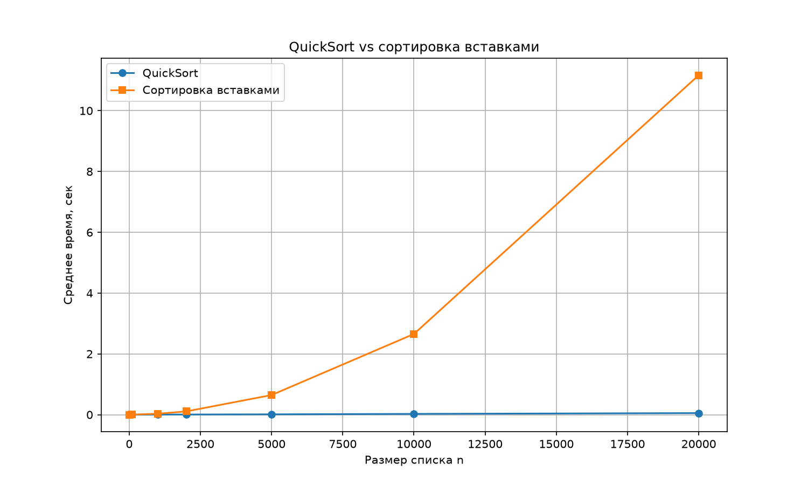

# Лабораторная работа: Стек вызовов. Быстрая сортировка

## Цель
Научиться работать со стеком вызовов, реализовать QuickSort и стратегию «разделяй и властвуй».

## Файлы проекта
- `recursion.py` — фибоначчи и максимум через «разделяй и властвуй».
- `sorts.py` — QuickSort и сортировка вставками.
- `demo.py` — демонстрация и трассировка стека для fib(5).
- `experiments.py` — замеры и график.
- `quicksort_comparison.png` — график.
- `results.md` — таблица результатов.

## Реализация

### 1. Рекурсивный Фибоначчи

```python
def fibonacci(n):
    if n == 0:
        return 0
    if n == 1:
        return 1
    return fibonacci(n - 1) + fibonacci(n - 2)
```

Базовые случаи — `n == 0` и `n == 1`.
Сложность — O(2ⁿ), так как каждое значение вычисляется многократно.

### 2. Максимум списка (разделяй и властвуй)

```python
def find_max(arr):
    if len(arr) == 1:
        return arr[0]
    mid = len(arr) // 2
    left = find_max(arr[:mid])
    right = find_max(arr[mid:])
    return max(left, right)
```

Список делится пополам, в каждой половине рекурсивно находится максимум,
затем берётся больший из двух. Сложность — O(n), глубина рекурсии — O(log n).

### 3. QuickSort

```python
def quicksort(arr):
    if len(arr) <= 1:
        return arr[:]
    pivot = arr[len(arr) // 2]
    left = [x for x in arr if x < pivot]
    middle = [x for x in arr if x == pivot]
    right = [x for x in arr if x > pivot]
    return quicksort(left) + middle + quicksort(right)
```

Опорный элемент — средний. Так QuickSort не деградирует до O(n²) на уже
отсортированных данных. Средняя сложность — O(n log n), худшая — O(n²).
Дополнительная память — O(n) из-за создания новых списков.

## Анализ стека вызовов для fib(5)

Дерево вызовов:

```
                       fib(5)
                    /          \
              fib(4)              fib(3)
            /       \            /       \
        fib(3)     fib(2)      fib(2)    fib(1)
       /     \     /    \      /    \
   fib(2)  fib(1) fib(1) fib(0) fib(1) fib(0)
   /    \
fib(1) fib(0)
```

Что видно:

- `fib(3)` вызывается 2 раза, `fib(2)` — 3 раза, `fib(1)` — 5 раз, `fib(0)` — 3 раза.
- Всего вызовов для fib(5) — **15**.
- Максимальная глубина стека — **6** кадров: fib(5) → fib(4) → fib(3) → fib(2) → fib(1) → fib(0).
- Многократный пересчёт одних и тех же значений — причина экспоненциальной сложности O(2ⁿ).

Улучшение: мемоизация через `functools.lru_cache` снижает сложность до O(n),
но в задании нужна именно чистая рекурсия.

## Результаты замеров QuickSort vs вставки
| n | QuickSort, с | Вставками, с |
|---|---|---|
| 10 | 0.000011 | 0.000004 |
| 100 | 0.000325 | 0.000555 |
| 1000 | 0.003060 | 0.031488 |
| 2000 | 0.005171 | 0.103423 |
| 5000 | 0.011538 | 0.646277 |
| 10000 | 0.025234 | 2.657824 |
| 20000 | 0.051915 | 11.352082 |



## Анализ результатов

- На маленьких списках (n = 10) обе сортировки работают мгновенно.
- На n = 1000 QuickSort в несколько раз быстрее вставок.
- На n ≥ 5000 разница становится огромной: вставки квадратичны, QuickSort — n log n.
- Рост времени QuickSort примерно линейно-логарифмический, у вставок — квадратичный.

## Вывод

QuickSort благодаря стратегии «разделяй и властвуй» работает за O(n log n)
и существенно превосходит квадратичные сортировки на больших данных.
Рекурсия наглядно демонстрирует работу стека вызовов — на примере Фибоначчи
видно, как одни и те же подзадачи пересчитываются многократно, что и даёт
экспоненциальную сложность.